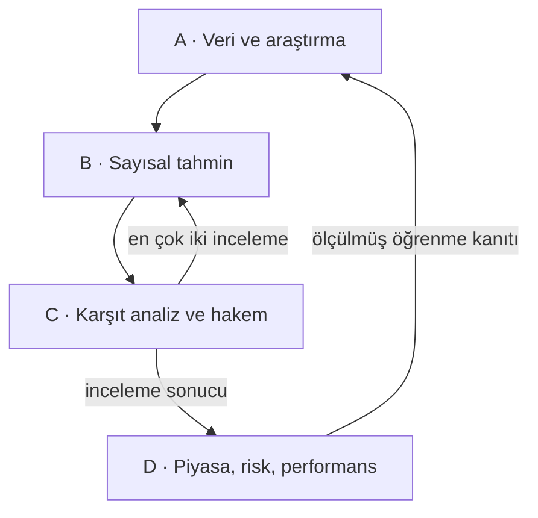

# AI Betting Lab — sistem anayasası ve Aşama 0 mimarisi

Bu teslimat, kullanıcının Aşama 2 ZIP'i üzerine eklenmiş altyapıdır. Eski `betting_lab/`, `engine/`, modeller, kaynak politikaları, raporlar ve `001/002` migration dosyaları byte düzeyinde korunur. Yeni kod `foundation/`, yeni testler `tests_foundation/`, yeni migration `003_multi_agent_foundation.sql` içindedir. Eski Aşama 1/2 adları teslimat geçmişini; yeni yol haritasındaki Aşama 0 ise ortak altyapı aşamasını ifade eder.

## Değişmez koşullar

Futbol tahmin motoru ve bahis karar motoru ayrı kalır. Başlangıç sanal bakiye 1.000 TL, günlük harcama üst sınırı 100 TL, strateji Balanced ve kapalı pilot süresi 7 gündür. Sıfır bahis geçerli karardır; kayıp telafisi için otomatik tutar artırma yoktur. Gerçek para, gerçek bahis hesabı, otomatik giriş veya gerçek bahis gönderme kodu yoktur. Ücretli API/LLM/VPS/proxy zorunluluğu yoktur.

Kullanıcının bildirdiği 50 TL minimum kupon, `coupon_rule_versions` içinde `user_reported_unverified` ve `enabled=false` olarak saklanır. Nesine'nin güncel bütün piyasalarına uygulanmış doğrulanmış bir kural değildir. Eski 10 TL tek bahis sınırı değişmez; yeni kupon toplam bedeli ayrı kavramdır. MBS, kolon, misli, kupon türü ve seçimler ayrı alanlardır. Aşama 0 yalnız tek seçimlik sanal rezervasyon ve iptal/iade temelini uygular. Kazanma/kaybetme, kombine ve sistem hesapları gelecektedir.

## Dört motor

Motor A: koordinatör, kaynak avcısı, veri doğrulayıcı, kadro/taktik ve dış tahmin araştırmacısı. Motor B: takım gücü, skor simülasyonu, özel piyasalar ve sentez. Motor C: Red Team ve bilimsel hakem. Motor D: oran analisti, risk yöneticisi, sonuç/öğrenme denetçisi. Ayrıntılı girdi, çıktı, yetki ve gerçek uygulama durumu `AGENT_ROLES.md` içindedir.

## Mevcut modüller nasıl kullanılıyor?

| Modül | Mevcut görev | Aşama 0 ilişkisi |
|---|---|---|
| betting_lab/store.py | SQLite snapshot ve atomik HTTP kota rezervasyonu | Aynı veritabanı ve sayaçlar kullanılır |
| betting_lab/adapters/ | İlk OpenLigaDB/OpenFootball ayrıştırma | Korunur |
| betting_lab/identity.py | İlk kimlik eşleştirme | Korunur; yeni canonical ID bağları SQL'de |
| engine/adapters.py | 7 bağımsız kaynak adapteri | Yeniden yazılmadı |
| engine/queue.py | Kaynak kuyruğu, cache, kota, cooldown, sağlık | Runtime içinde Queue nesnesi olarak kullanılır |
| engine/normalization.py | Çelişkileri karantinaya alma, cached replay | Aynen korunur |
| engine/dataset.py | Hedef ayrımı, zaman bölmesi, manifest | Model giriş sözleşmelerinin temeli |
| engine/models.py | Baseline, Elo, Poisson, Dixon–Coles | Runtime.predict bu matematiği çağırır |
| engine/evaluate.py | Kronolojik holdout, Brier/log loss, reliability | Mevcut raporlar korunur; bu aşama yeni model deneyi değildir |
| engine/predict.py | Sonuçsuz fikstürden model tahmini | Rol, provenance ve revizyon katmanının altında kullanılır |
| engine/bootstrap.py | CC0 kanıt ve sayaç birleştirme | Sayaç sıfırlanmaz; yeni Foundation da aynı Queue'yu kullanır |
| foundation/contracts.py | Sürümlü Pydantic sözleşmeleri | Şema ve ek alan kontrolü |
| foundation/runtime.py | Yerel DAG işleri, kanıt, mesaj, hakem, revizyon ve hash zinciri | Çalışan yerel altyapı |
| foundation/roles.py | 14 rolün girdi/çıktı ve yetki kayıtları | Hedef ve uygulanmış işlevler ayrıdır |
| foundation/demo.py | Sentetik Red Team → Hakem → reanalysis → abstain akışı | Ağsız, sanal para harcamayan örnek |
| foundation/export.py | JSON Schema ve bütünlük dışa aktarımı | Bağımsız hash kontrolü için checkpoint |

Tam import envanteri `reports/phase0/module-inventory.json` içindedir.

## Kalıcı görev ve yürütme sınırı

Sekiz görev türü vardır: collect, validate, model, red_team, referee, reanalysis, save_prediction, settle. Bağımlı görev yalnız önceki görevler `done` olduğunda alınır. Yeni görev yalnız var olan görevlere bağlandığı için RPC üzerinden döngü kurulamaz. Başarısız bağımlılık çocuğu `blocked` yapar. İdempotency key aynı içerikle aynı işi döndürür; farklı içerik hata verir. Lease bir worker'a aittir; timeout sonunda yeni token ile tekrar alınır. Maksimum deneme sayısı aşılınca failed olur. Geri deneme gecikmesi artar. Eski token işi tamamlayamaz.

SQLite tarafında `BEGIN IMMEDIATE`; PostgreSQL tarafında `FOR UPDATE SKIP LOCKED` kullanılır. SQLite'ın iki ayrı bağlantıyla gerçek eşzamanlı claim testi çalıştırıldı. Bağımsız PostgreSQL sunucu oturumları bu ortamda çalıştırılamadı. PGlite ardışık lease kontrolleri bu testin yerine sayılmadı.

Lease süresi iş sahipliği sınırıdır; başka bir süreçte çalışan uzun Python hesaplamasını fiziksel olarak öldüren süreç yöneticisi bu aşamada yoktur. Sekiz iş türünün kuyruk/rol sözleşmesi vardır; bütün gelecek uzmanlarının araştırma yürütücüleri yoktur. Mevcut kaynak toplama `engine.Queue` üzerinden çalışır. Yeni otomatik günlük üretim zamanlayıcısı açılmadı.

## Tahmin ve denetim

Tahminlerin V1 ve V2 kayıtları ayrıdır; önceki revizyon FK ile bağlanır. Rol sadece score_engine ise mevcut sayısal model çağrılır. Mesajda probability gibi bilinmeyen alanlar reddedilir; numeric_override yalnız null olabilir. LLM ile üretilmiş JSON varsa önce Pydantic, ardından kaynak/kanıt/fixture/zaman denetiminden geçmelidir. Serbest metin notu karar üretmek için çalıştırılmaz.

Hakem ilk çözülmemiş incelemede `needs_reanalysis`, ikinci incelemede `abstain` ve risk için `skip` verir. Yeni doğrulanmış kanıtın yapısal kontrolleri geçmesi `approved` üretebilir; bu, kaynağın futbol iddiasının bilimsel olarak doğru olduğunu veya müdahalenin performansı artırdığını kanıtlamaz. Gerçek senaryo hesabı ve Red Team ablation ölçümü sonraki aşamadadır. Hakem onayı tek başına bahis açmaz; risk, oran, model, saat ve cüzdan kapıları ayrıca gerekir.

`regulation90`, `final_including_extra_time`, `provider_final_unknown` açıkça ayrılır. Yeni 1X2 sanal kupon yolu yalnız regulation90 kabul eder. Retrospective tahmin sanal kupona giremez. İlk/ikinci yarı için veri yokken `unsupported/insufficient_data` ve probability=null sözleşmesi kullanılır. Gol beklentisini keyfî ikiye bölme kodu yoktur.

## Güvenlik ve dağıtım durumu

PostgreSQL rol grupları NOLOGIN'dir; kullanıcı/worker login hesabına üyelik üretim kurulumu sırasında ayrıca verilir. Tarayıcıya servis anahtarı verilmez. `lab` şeması Data API'ye açılmamıştır. `lab_dashboard` yalnız üç araştırma çıktısını okuyabilir. Bu tek proje için rol ayrımıdır; çok kiracılı `auth.uid()` uygulama yetkilendirmesi değildir. Hosted Supabase Auth/JWT/RLS entegrasyonu yapılmadı.

Yerel SQLite dosyasına yazabilen süreç güvenilir kabul edilir. Rol parametresi işletim sistemi kimlik doğrulaması yerine geçmez. Gerçek yetki sınırı için SQL rolleri ve ayrı worker kimlikleri kullanılmalıdır. DBA tetikleyiciyi kaldırıp kayıt/hash değiştirebilir; append-only teknik olarak DBA'ya karşı değişmezlik garantisi değildir. Yerel SHA-256 zinciri ve ayrı saklanan export hash'i tahrif tespiti sağlar; dış imzalı sabitleme servisi kurulmadı.

Supabase Free saklama, Vercel ve GitHub planı `DEPLOYMENT.md` içindedir. Hiçbir bulut hesabına bu teslimatta deployment yapılmadı.
