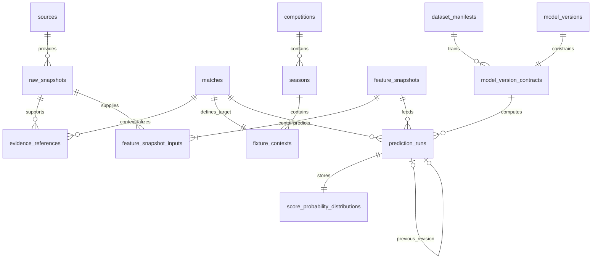
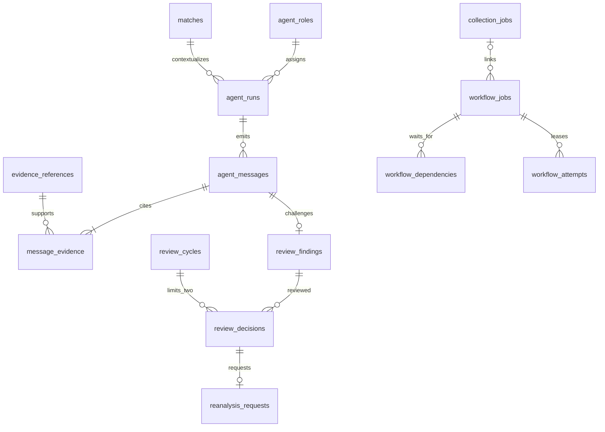
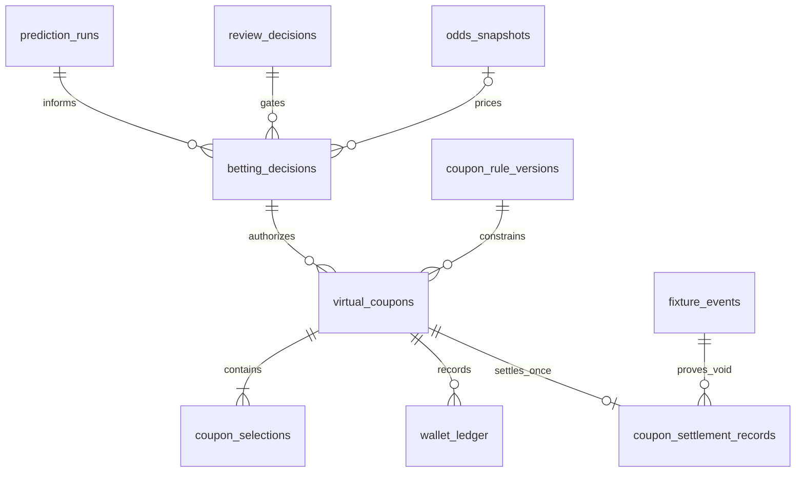

# Veritabanı şeması, ilişkiler ve güvenlik

`001_lab.sql` ve `002_research_engine.sql` değiştirilmedi. `003_multi_agent_foundation.sql` yalnız ek tablo/fonksiyon/indeks/tetikleyici/rol ekler; mevcut wallet_ledger'a nullable coupon_id FK ve en çok bir bahis referansı kuralı eklenir. Eski kaynak, maç, model, cüzdan ve değerlendirme tabloları yeniden oluşturulmaz.

## Kavramların karşılığı

| Kavram | Yeniden kullanılan yapı | Ek yapı / amaç |
|---|---|---|
| Kaynak | sources | source_access_policies: sürümlü beş durum, izin, lisans, kota ve son inceleme |
| Kaynak sağlık ve gözlem | source_health, source_observations, ingestion_runs, raw_snapshots | source_dependencies: ortak upstream ve kanıt snapshot FK |
| Kaynak görevleri | collection_jobs, quota_usage | workflow_jobs.collection_job_id bağlantısı; yeni kaynak kotası RPC |
| Lig/sezon | matches.competition/season metni korunur | competitions, seasons, fixture_contexts ile canonical bağ |
| Takımlar/fikstür | teams, matches, team_aliases, match_aliases, match_versions | canonical_mappings ve fixture_events |
| Veri snapshot | raw_snapshots, normalization_runs, research_results | evidence_references: fixture/source/snapshot/target ve kalite |
| Özellik/veri kümesi | dataset_manifests | feature_snapshots + feature_snapshot_inputs |
| Model sürümleri | model_versions, research_model_runs | model_version_contracts: dataset, hedef, artifact URI/hash |
| Tahmin ve skor | predictions, research_score_predictions korunur | prediction_runs revizyon zinciri + score_probability_distributions |
| Champion/Challenger | model_versions.role, one_champion indeksi | champion_promotions: kanıtlı terfi kaydı; otomatik terfi yok |
| Uzman roller/çalışmalar | — | agent_roles ve agent_runs |
| Mesaj ve kanıt bağlantıları | — | agent_messages, message_evidence, message_snapshots |
| İtiraz/hakem/yeniden analiz | — | review_findings, review_cycles, review_decisions, reanalysis_requests |
| Kalıcı görev/deneme | collection_jobs korunur | workflow_jobs, workflow_dependencies, workflow_attempts |
| Oran | odds_snapshots | 1X2 kapsamı korunur; yeni oran toplama yok |
| Risk kararı | — | betting_decisions: bet/wait/skip, azami risk, hakem ve tahmin FK |
| Kupon ve seçim | paper_bets korunur | coupon_rule_versions, virtual_coupons, coupon_selections |
| Cüzdan/sonuçlandırma | paper_wallet, wallet_ledger, settlements | coupon_settlement_records: kupon başına tek sonuçlandırma |
| Değerlendirme | evaluation_runs | calibration_reports, ablation_results, source_performance, model_performance |
| Saklama/denetim | mevcut immutable tetikleyiciler | storage_policies, audit_events, integrity_exports |

Legacy sources.status (`approved/blocked/pending`) değiştirilmez. Yeni politikalarda `approved/conditional/blocked/pending_review/disabled` vardır. Python dönüşümü pending ve pending_* durumlarını pending_review'a, tanınmayanları disabled'a çevirir. Yeni toplama için hem legacy kaynak onayı hem yeni güncel politika gerekir. Conditional otomatik onay değildir.

## ER diyagramı — kanıt ve tahmin

## ER diyagramı — rol, görev ve inceleme

## ER diyagramı — sanal kararlar

ER çizimleri ana ilişkileri gösterir; bütün kısıtların yetkili tanımı SQL migration'dır. `review_cycles` ile karar bağlantısı fixture_id üzerinden kurulur; run/rol/fixture için agent_messages'ta bileşik FK bulunur.

## Kısıtlar ve indeksler

UUID kimlikleri mevcut lab anahtarlarına bağlanır. Kaynaksız evidence, olmayan fixture/model, eksik snapshot, tekrarlanan message_id ve ikinci coupon settlement PK/FK/unique ile reddedilir. Canonical mapping takım/fikstür/ligden tam birine bağlanır; kaynak/native ID için tür bazında partial unique indeksleri vardır. İş kuyruğunda role/status/not_before; kuponlarda budget_day/status indeksleri bulunur. Tahminlerde `(fixture_id,model_version_id,revision)`, incelemede `(fixture_id,round_no)`, politikalarda `(source_id,revision)` tektir.

Tahmin kayıt RPC'si fixture satırını kilitler ve revision zincirini oluşturur. Model, dataset, feature ve fixture hedefleri eşleşmelidir. Eğitim tarihi ve feature_time tahmin kesiminden sonra olamaz. Prematch kayıt, kickoff'tan önce oluşturulmalı; feature girdilerinin gerçek snapshot gözlem zamanı kesimi geçmemelidir. Sonradan indirilen tarihsel arşiv `retrospective` olarak ayrı kalır.

Skor dağılımı hücreleri Poisson×Dixon–Coles parametreleriyle tekrar kontrol edilir. Grid+tail toplamı ve 1X2 toplamı 1 olmalıdır. 1X2 değerleri griddeki kütle ile kuyruk sınırlarına uymalıdır. Parametre/olasılık aralıkları NaN/sonsuz değerleri engeller. Genel gelecek modeller için bu tabloyu izinsiz esnetmek yerine yeni sürümlü dağılım sözleşmesi gerekir.

## Rol ve RPC sınırı

Normal roller için doğrudan INSERT/UPDATE/DELETE yetkisi verilmez. Worker rolleri `lab_<agent_role>` NOLOGIN grup rolleridir. Her RPC `current_setting('role')` / session_user üzerinden gerçek rol üyeliğini kontrol eder; JSON içindeki agent_role tek başına yetki sağlamaz. SECURITY DEFINER fonksiyonlarının search_path'i pg_catalog,lab ile sabittir. PUBLIC fonksiyon/tablo/sequence erişimi kapalıdır.

| RPC | Yetkili rol | Davranış |
|---|---|---|
| start_agent_run / post_agent_message | Çağırdığı role üye worker | Run/fixture/kanıt ve şema denetimi |
| register_evidence | data_validator | Kaynak/snapshot ilişkisi ve gözlem zamanı server verisinden |
| record_prediction | score_engine | Append-only yeni revizyon ve matematik kontrolü |
| enqueue_workflow | coordinator | İdempotent bağımlı görev oluşturma |
| claim_workflow / finish_workflow | Görevin atanmış rolü | Satır kilidi, lease token, retry/timeout |
| decide_review | scientific_referee | Fixture kilidi altında en çok iki karar |
| reserve_source_request | source_hunter | Kaynak kilidi altında güncel izin ve kota kontrolü |
| reserve_virtual_coupon | risk_manager | Kapalı pilot/kural kapıları, ortak cüzdan kilidi, gerçek oran ve inceleme |
| settle_coupon_void | risk_manager | Yalnız doğrulanmış iptal, finanse edilmiş tekli kupon, idempotent iade |

`lab_dashboard` sadece prediction_runs, score_probability_distributions ve review_decisions okuyabilir. anon/authenticated/service_role için yeni grant yoktur. Kullanıcı JWT'sine role adı eklemek bu SQL rolüne üyelik vermez. Supabase Auth entegrasyonu ayrıca test edilmelidir. Kimlik/kadro/özellik/model metadata'sını ilk kuran migration/veri yükleme yönetim süreci güvenilir kabul edilir; bu tablolar için bütün üretim yazma servisleri geliştirilmedi.

## Cüzdan ve 100 TL ortak sınır

Eski place_paper_bet ve yeni reserve_virtual_coupon aynı `paper_wallet(id=1)` satırını kilitler. Yeni BEFORE INSERT budget tetikleyicisi, paper_bets ve virtual_coupons günlük harcamalarını birlikte toplar; açık riski de birlikte kontrol eder. Gün Europe/Istanbul sunucu saatinden gelir. İptal/iade günlük harcamayı azaltmaz. Cüzdan ve ledger aynı transaction içinde değişir. Aynı anahtar farklı istekle kullanılırsa idempotency_conflict oluşur.

Yeni sanal kupon, `bet` kararı olsa bile aktif pilot, etkin kural, minimum/maximum tutar, azami risk miktarı, güncel onaylı hakem turu, champion, regulation90, güncel gerçek oran ve aynı maç için açık risk kontrollerini geçmelidir. 50 TL varsayımı 10 TL eski tek bahis sınırlamasını sessizce değiştirmez. Gelecekteki kombine/sistem motoru hazır değildir.

## Append-only ve yönetici sınırı

Kanıt, mesaj, finding, karar, model sözleşmesi, prediction run, dağılım, deneme geçmişi, değerlendirme ve ledger UPDATE/DELETE tetikleyicileriyle korunur. İş durumu, review cycle, sağlık ve kuponun açık/settled durumu fonksiyonlarla güncellenebilir. PostgreSQL yöneticisi rol veya tetikleyici değiştirerek bu korumayı kaldırabilir; mutlak değiştirilemezlik iddiası yoktur. Yerel hash zinciri ve dışa aktarılmış checkpoint bağımsız yerde saklanmalıdır.

Yeni ham JSON için 64 KiB server sınırı vardır; büyük arşivler dış depoda, SQL'de URI/hash/metadata olarak tutulmalıdır. `storage_policies` saklama tasarımıdır; otomatik silme worker'ı uygulanmadı. Append-only denetim kayıtları normal worker tarafından silinmez. Kota sayaçlarının SQLite ve PostgreSQL arasında otomatik taşınması yoktur: üretim geçişinde tek yetkili sayaç seçilip geçmiş aktarılmadan iki toplama yolunu birlikte etkinleştirmeyin.
