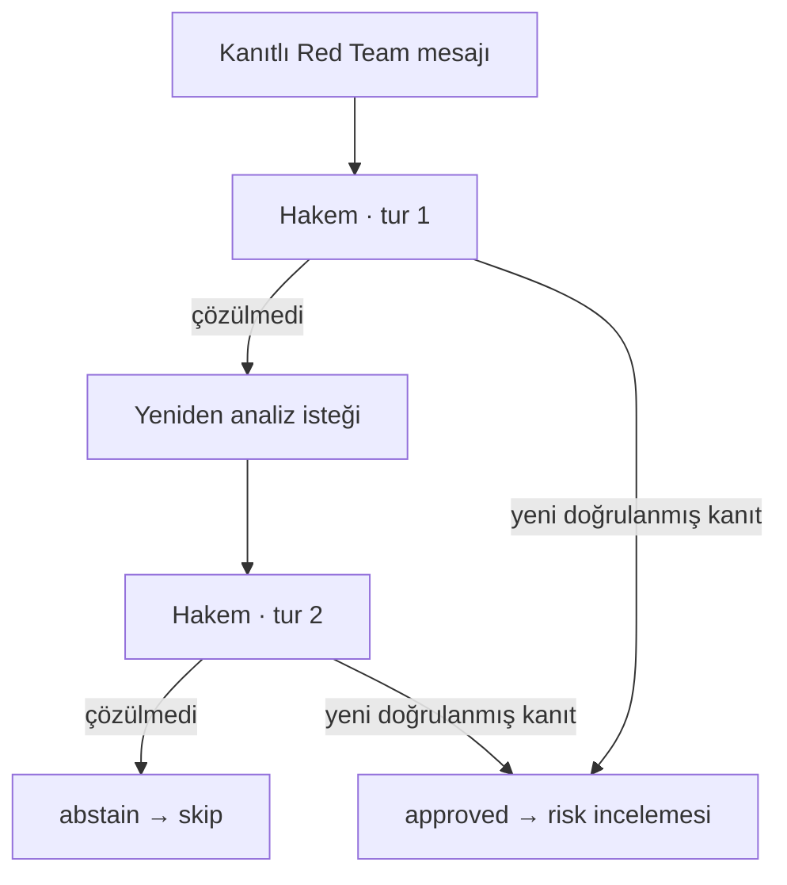

# Mesaj protokolü 1.0

Yetkili Python sözleşmeleri `foundation/contracts.py`, üretilen JSON Schema'lar `schemas/phase0/` içindedir. Şema dosyaları şu komutla yeniden üretilir:

```bash
python -m foundation.export
```

AgentMessage, Evidence, ReviewDecision, JobRequest ve UnsupportedMarket sözleşmeleri vardır. `extra=forbid` bilinmeyen alanları reddeder; schema_version yalnız `1.0` olabilir. UUID kimlik, saat dilimli tarih, enum, boyut, tekrarsız referans ve numeric_override=null kontrolleri uygulanır. Mesaj en fazla 16 KiB'dir.

## Red Team mesajı

```json
{
  "schema_version": "1.0",
  "message_id": "00000000-0000-4000-8000-000000000001",
  "agent_run_id": "00000000-0000-4000-8000-000000000002",
  "fixture_id": "00000000-0000-4000-8000-000000000003",
  "agent_role": "red_team",
  "created_at": "2026-10-15T00:00:00+00:00",
  "input_snapshot_ids": ["00000000-0000-4000-8000-000000000004"],
  "evidence_ids": ["00000000-0000-4000-8000-000000000005"],
  "model_version_id": null,
  "issue_type": "lineup_uncertainty",
  "severity": "critical",
  "requested_action": "scenario_analysis",
  "status": "pending_review",
  "numeric_override": null,
  "note": "SENTETİK şema örneği; gerçek oyuncu sakatlığı iddiası değildir."
}
```

Bu örnek yalnız şekil olarak geçerlidir. DB'de run, fixture, snapshot ve evidence ID'leri bulunmadan kabul edilmez. Yerel SQLite snapshot ID'leri eski engine'nin SHA-256 kimlikleridir; Supabase raw_snapshots UUID kullanır. İki ortam arasında import yapılırsa açık kimlik eşleme tablosu gerekir; ID biçimleri birbirine kopyalanmaz.

## Semantik denetim sırası

1. Pydantic şema doğrulaması; bilinmeyen alan, sürüm, yanlış tip ve numeric_override reddi.
2. DB/worker kimliği ile agent_role eşleşmesi; run ile fixture eşleşmesi.
3. Bütün evidence ve snapshot referanslarının varlığı; aynı fixture ve hedefe ait olması.
4. Gözlem/yayın/run zamanı tutarlılığı; prematch akışta gelecekte görülen veri reddi.
5. Kaynak erişim politikası ve kalite durumu; unknown/conflicting kayıt silinmez veya zorla verified yapılmaz.
6. Mesaj ID aynı içerikle yeniden geldiyse aynı sonucu döndürme; farklı içerikte conflict.
7. Red Team/veri doğrulayıcı mesajından finding oluşturma ve kalıcı denetim kaydı.

Pydantic bir iddianın doğru olduğunu kanıtlamaz. Kaynak metni güvenilmeyen veridir; notlar SQL veya Python komutu olarak çalıştırılmaz. LLM çıktıları doğrudan parametre veya probability tablosuna taşınmaz. Model parametre değişimi ancak izinli sayısal eğitim/senaryo yürütücüsünün ayrı sürümünde yapılabilir.

## İki tur protokolü



Aynı fixture için en fazla iki inceleme kararı vardır. Aynı idempotency key ile retry tur tüketmez. İkinci çözülmemiş karar skip üretir, üçüncü çağrı reddedilir. Onay için önceki mesajın kanıtlarını tekrar kullanmak yeterli değildir; yeni, aynı fixture'a bağlı verified kanıt ve uygun gözlem zamanı gerekir. Gerçek bilimsel hata çözümünün değerlendirmesi ve senaryo modeli gelecekte genişletilecektir. Aşama 0 yapısal kontrolü uygulayan bir temel sağlar.

`reports/phase0/demo.json` gerçekten çalıştırılmış sentetik örnektir. ReviewDecision çıktısında schema_version, decision_id, agent_run_id, fixture_id, agent_role, created_at, finding_id, round_no, status, risk_action, reason ve numeric_override vardır. SQL decide_review UUID döndürür; ilişkisel karar kaydı aynı anlamdaki alanları saklar. Python çıktı serileştiricisi `Runtime.review_record` içindedir.

Desteklenmeyen bir piyasa örneği: `{"schema_version":"1.0","market":"first_half_btts","status":"insufficient_data","probability":null,"reason":"Doğrulanmış yarı bazlı veri yok"}`. Bir sayı eklenirse sözleşme reddeder.

## Görev protokolü

JobRequest schema_version, idempotency_key, kind, optional fixture_id, max_attempts ve timeout_seconds içerir. Bağımlılıklar ayrı kalıcı FK kayıtlarıdır. Retry yeni mesaj üretmek zorunda değildir; işlem anahtarının aynı payload ile tekrar kullanımı güvenlidir. SQL workflow_jobs ayrıca sınırlı metadata parameters alanı tutar; bu alan çalıştırılabilir kod veya LLM için keyfî sayısal override kanalı değildir.
