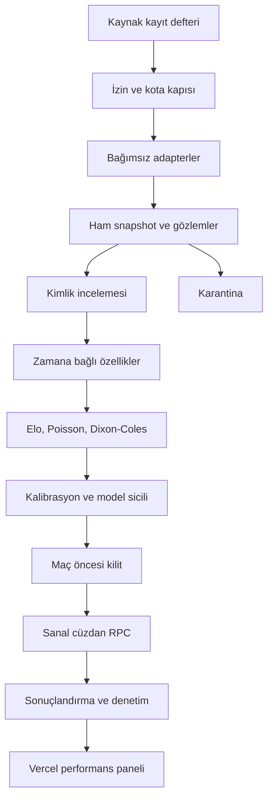

# Mimari kararı — v0.1

## Hedef ve sınır

Sistem futbol skorlarının olasılık dağılımını sayısal modellerle üretir. Sadece sanal TRY kullanır. Gerçek bahis hesabı, para yatırma/çekme, ödeme sağlayıcısı veya gerçek bahis gönderme endpoint'i bulunmayacak. LLM zorunlu bağımlılık değildir. Bugünkü teslim veri toplama ve güvenli veritabanı temeliyle sınırlıdır.

İlk araştırma evreni Bundesliga; iki açık kaynak aynı ligde tutarlılık kontrolüne izin verir. Türkiye ligi veya çok sayıda ligi aynı anda kapsama iddiası yok. Kapsam, ücretsiz oran ve fikstür kesişimi doğrulanınca genişletilir.

## Bileşenler ve akış

- **Python worker / GitHub Actions:** sonlu süreli toplama, eğitim, değerlendirme, ileride paper işlem ve settlement görevleri. Cron kesin zaman garantisi sayılmaz. İş geç kalırsa maç öncesi kontroller işlemi reddeder.
- **Supabase PostgreSQL:** üretimde kalıcı kaynak geçmişi, kota ve iş kilitleri, model/kupon/wallet denetim kayıtları. Büyük ham dosyalar için ileride Supabase Storage; şu an küçük JSON gövdeleri yeterli.
- **Vercel:** ileride özel Next.js performans paneli; veriler worker'dan değil DB'den okunur. Uzun ML işleri Vercel request'inde çalışmaz.
- **Yerel SQLite:** bu aşamada bağlantısız geliştirme ve prototip deposu; üretim parasal yetki alanı değildir. Gerçek wallet SQL'dedir.
- **LLM:** eklenirse kaynak URL'si, alıntı aralığı, yayın/edinim zamanı ile yapılandırılmış araştırma. Olasılık, veri yokken sakatlık veya kadro üretmez.

## Kaynak keşfi ve adapter sözleşmesi

Keşif, otomatik scraping izni değildir. Aday kaynağa license URL, inceleme tarihi/bitişi, authentication türü, kapsam, data freshness, sağlayıcı kotası ve kendi güvenlik bütçemiz atanır. `approved` dışındaki kaynak çağrılmaz. İnceleme süresi bitince toplama durur. CAPTCHA, giriş veya engel aşma yok.

Aşama 1 keşif kaydı araştırılarak hazırlanmıştır; sürekli otonom web araması henüz yoktur. Sonraki aşamada yeni adayları bir inceleme kuyruğuna alan görev eklenir; izin kararı otomatik varsayılmaz.

Her adapter `url(season)`, `rows(payload)`, `parse(row, season)` uygular. Ağ, saat, DB, kota ve retry parser dışında kalır. Başarısız satır karantinaya gider, sağlam satırlar korunur. HTTP timeout 20 saniye; response üst sınırı 2 MB; yönlendirmeler reddedilir. 401/403/429 en az 24 saat durdurur; daha uzun Retry-After korunur. Başarısız ağ çağrısı da kota tüketir. İkinci kaynak bağımsız çalışır.

Üretim çoklu worker ortak PostgreSQL sayaç ve advisory lock kullanmalıdır. Yerel sayaç sadece aynı SQLite dosyasını paylaşan süreçlerde atomiktir. Dağıtık toplama kabul testinden önce üretim cron'u açılmaz.

## Kimlik ve veri kalitesi

Kaynak içi ID korunur. Kaynaklar arası takım kimliği ülke/lig/cinsiyet/yaş kategorisi bağlamındaki açık alias ile eşlenir; benzer isimler sessizce birleştirilmez. 2024/25 için 18 takımın alias'ı vardır. Üç açık isim varyantı: VfL Bochum 1848 → VfL Bochum, TSG 1899 Hoffenheim → TSG Hoffenheim, FC St. Pauli 1910 → FC St. Pauli.

Maç adayında lig/sezon/ev sahibi/deplasman/yerel tarih karşılaştırılır. Tarih, kalıcı canonical ID yapılmaz; ertelemede kimlik kayması böyle önlenir. Aynı adayda skor çelişkisi veya aynı kaynaktan çift kayıt varsa `conflict`. Adaylar manuel/onaylı bir çözümleyici incelemesi olmadan canonical maça terfi etmez. OpenFootball native ID vermediği için kaynak içi round+teams hash'i kullanılır; round yoksa tarih fallback'i ayrı kimlik incelemesi gerektirir.

OpenLigaDB açık UTC kickoff verir. Offset içermeyen lastUpdate alanı raw tutulur, UTC uydurulmaz. OpenFootball saatini belgelenmiş bir offset olmadan UTC'ye çevirmiyoruz: kickoff NULL kalır. Eksik skor 0 sayılmaz, eksik oran ortalamadan oluşturulmaz. `unknown` durum kupona uygun değildir. Logo/görsel hakları bu veri lisanslarından çıkarılmaz.

## Zamansal doğruluk

Her kayıt için `received_at/observed_at` yerel edinim zamanı; `source_updated_at` yalnızca kaynak açıkça sağlarsa; kickoff olayın başlangıcıdır. Bu zamanlar birbirinin yerine geçmez. Feature join, model karar anında gerçekten edinilmiş snapshot'ları kullanır. Sonradan düzeltilen sonuç önceki snapshot'ı silmez.

Bugün indirilen 2024 sonuçları **2024'te gözlenmiş veri değildir**. Araştırma amaçlı retrospective backtest yapılabilir ama edinim zamanı doğrulanmış paper forward-test ile ayrı raporlanır. Oran geçmişi yoksa eski kârlılık hesabı üretilemez. Exact skor tahmin başarısı ile 1X2 başarısı ayrı metriklerdir.

## Sayısal model sıralaması — sonraki aşama

1. **Elo:** yalnız geçmiş sonuçlarla takım gücü günceller; aynı başlama anındaki maçlar topluca tahmin edilir, sonuçlar sonra güncellenir. Elo rating'den 1X2/beraberlik olasılığına dönüşüm ayrıca train/validation ile öğrenilir.
2. **Poisson:** ev/deplasman hücum-savunma parametreleri, ev avantajı ve düzenlileştirme. Bağımsız goller için P(h,a). Kuyruk kütlesi ayrıca hesaplanır; 0..N ızgara sessizce %100 sayılmaz.
3. **Dixon-Coles:** düşük skorlu hücre düzeltmesi, zaman ağırlığı; tau pozitifliği ve rho kısıtları, optimize convergence testleri.
4. **xG / LightGBM / XGBoost:** lisansı ve kapsamı uygun veri, yeterli örnek ve baseline üstünlüğü sağlanırsa. Eksik xG uydurulmaz; missingness açık feature olur.
5. **Ensemble:** yalnız out-of-fold ileri zaman tahminleriyle ağırlık öğrenme; dış kaynak kopyaları aynı bağımsız kanıt sayılmaz.

Train → validation → untouched test kronolojisi; expanding/rolling window. Ölçekleme, takım formu, lig ortalaması, hyperparameter ve kalibrasyon her fold'un eğitim geçmişinden hesaplanır. Test sonuçlarına göre tekrar tekrar model seçilmez. Kalibrasyon için yeterli validation örneği yoksa uygulanmamış olarak raporlanır.

Log loss, Brier, calibration bins, score log likelihood; pazar karşılaştırmasında normalize implied probability ve overround. ROI, turnover, drawdown, CLV yalnız gerçek oran snapshot'ı ve örnek sayısıyla gösterilir. Belirsizlik için maç/hafta blok bootstrap. 7 günlük test operasyonel denemedir; kârlılık kanıtı değildir.

## Dış tahmin kaynakları

Bugün dış tahmin sitelerine doğrulanmış başarı puanı atanmadı. Geçmişi sonradan düzenlenmiş sayfalardan geçmiş isabet iddiası kurulmaz. Tahminler maç öncesinde ileriye dönük arşivlenir. Örnek sayısı, kapsama, kayıp günler, timestamp kanıtı, log loss/Brier (olasılık varsa), selection-only isabeti ayrı tutulur. Seçim metninden olasılık uydurulmaz.

Bağımsızlık için ortak veri tedarikçisi, aynı metin/dağılım, zaman gecikmesi, koşullu hata korelasyonu ve ortak maç kapsamı incelenir. Korelasyon tek başına kopya kanıtı değildir. Kaynaklar cluster bazında ağırlıklandırılır; az örnekli kaynaklarda shrinkage ve sıfır başlangıç ağırlığı kullanılır.

## Champion/challenger

Her sürüm kod SHA, dataset hash, train cutoff, parametreler, fold manifest ve kalibratör sürümü saklar. Tek aktif champion için unique index var. Aşama 1'de model yok ve champion yoktur. Terfi: temporal leakage testleri, baseline karşılaştırması, örnek yeterliliği ve calibration gate. Günlük yedi maç iyi gitti diye otomatik terfi yapılmaz. Eski tahminlerin model_id'si değişmez.

## Balanced v1 ve pilot

1.000 TL başlangıç; 100 TL İstanbul takvim günü toplam stake üst sınırı. Tekli 1X2, maç başına en çok 10 TL ve açık toplam risk en çok 100 TL. Önerilen stake: min(quarter Kelly, bakiyenin %1'i, 10 TL, günlük kalan). Minimum edge 3 yüzde puanı araştırma başlangıç parametresidir, doğrulanmış optimum değildir.

Model veya taze oran yoksa `NO_BET`. Limit doldurulması hedef değildir. Günlük sınırı kazanç veya void yeniden açmaz. Karar kickoff'tan en az 5 dakika önce; oran yaşı en fazla 15 dakika. Bu tazelik sınırı ücretsiz kotayla az maça izin verebilir; çözüm kapsamı daraltmak, eski oranı yeni saymak değildir.

DB RPC bu aşamada limit, provenance, kilit ve idempotency iskeletini uygular; edge/quarter-Kelly hesaplayan strateji motoru ve settlement henüz yok. Bu yüzden RPC varsayılan kapalı ve hiçbir runtime role yetkisi verilmemiştir.

Pilot başlangıç tarihi, gerçek cloud kurulum ve kabul testleri bitince kaydedilir. 7 x 24 saat sonunda yeni kupon kapanır; açık kuponların sonuçlandırılması sürer. Erteleme/iptal için settlement v1 kuralları başlangıçtan önce kilitlenecek; 90 dakika+uzatma dakikaları, ekstra devre ve penaltılar hariç. Sonuç düzeltmesi yeni denetim hareketiyle yapılır.

## Ücretsiz altyapı sınırları

Supabase Free resmî sayfada 500 MB DB, 1 GB storage ve 5 GB egress gösteriyor; mevcut hesabın kalan hakkı ayrıca doğrulanmalı. Import DB 350 MB üzerindeyse durur; yerel collector 40 MB üzerinde yeni çağrı yapmaz. Bunlar tüm projedeki eşzamanlı tüketimi ölçen üretim quota manager yerine geçmez.

Vercel mevcut planında özel panel; Hobby kişisel/ticari olmayan kullanım koşulları kontrol edilir. GitHub standard runner ve account bütçesi doğrulanmadan CI kapısı açılmaz. `FREE_BUDGET_CONFIRMED=true` sadece gerçek kontrol sonrası ayarlanır. Üretim scheduler, provider/account seviyesinde sıfır ücretli kullanım kapaması ve kalıcı ortak sayaç olmadan etkinleşmez. Aşım olunca otomatik plan yükseltme veya ücretli fallback yok.
